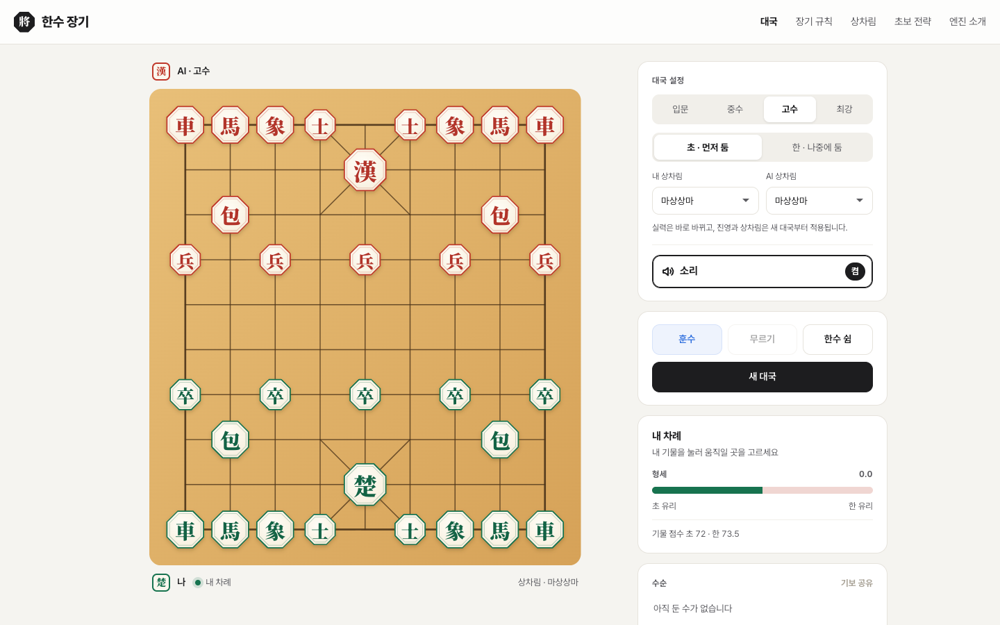
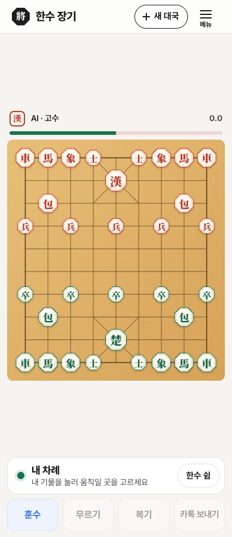

<div align="center">

# 한수 장기

**설치도 회원가입도 없이, 브라우저에서 바로 두는 장기 AI 대국**

오픈소스 엔진 [Fairy-Stockfish](https://github.com/fairy-stockfish/Fairy-Stockfish)가 서버가 아닌 방문자의 브라우저 안에서 직접 수를 읽습니다.

### [hansujanggi.com](https://hansujanggi.com) 에서 바로 두기


-654ff0)

</div>

<p align="center">
  
  &nbsp;
  
</p>

## 주요 기능

- **AI 대국**: 실력 4단계(입문 · 중수 · 고수 · 최강), 초/한 진영 선택, 상차림 4종 + 무작위
- **배우며 두기**: 훈수 화살표, 무르기, 한수 쉼, 형세 막대, 기물 점수, 수순 기록
- **복기**: 수순을 누르거나 ◀ ▶ · 방향키로 지난 국면을 넘겨 보고, 그 국면에서 훈수 보기
- **기보 공유**: 대국을 링크 하나(`#g=…`)에 담아 공유. 서버 저장 없이 주소에 수순이 들어 있고, 받은 사람은 보기 전용으로 복기
- **대국 분석**: 엔진이 국면마다 다시 읽어 형세 그래프, 부정확(?!)·실수(?)·패착(??) 표시, 진영별 정확도, 복기 중 최선 수 화살표를 보여 줌. 모두 브라우저 안에서 계산
- **이어하기**: 진행 중인 대국을 브라우저 저장소에 보관해 다시 방문해도 이어서 둠
- **스크롤 없는 휴대폰 화면**: 대국·복기·공유를 한 화면에서. 판 아래 큰 버튼(훈수·무르기·복기·카톡 보내기), 아래에서 올라오는 새 대국 설정
- **쉬운 복기(휴대폰)**: 수마다 '좋은 수·아쉬운 수·실수·큰 실수'와 승률 변화, 더 좋은 수를 파란 화살표로. 형세 막대를 눌러 이동하고 '다음 실수'로 건너뛰기
- **보기 편하게**: 진한 보조 글자와 큰 휴대폰 글씨, 아이콘마다 글자 표시, 착수 소리(메뉴·설정의 '소리'로 끄기), AI가 둔 수 깜빡임
- **반응형**: 데스크탑 · 태블릿 · 모바일 각각에 맞춘 배치
- **한국어 · English**: 머리말의 번역 아이콘으로 바꾸기. 처음에는 브라우저 언어를 따름 (한국어면 한국어, 그 밖에는 영어)
- **서버 비용 0원**: 정적 파일만으로 동작하고, 계산은 각자의 기기가 함
- **글 페이지**: 장기 규칙, 상차림 가이드, 초보 전략, 엔진 소개

## 구조

```
site/                         배포 폴더 (빌드 단계 없음)
├── index.html                대국 화면
├── rules/ setups/ strategy/  글 페이지 ─┐
├── engine/ privacy/ source/            ─┤ tools/build_pages.py 로 생성
├── en/                       영어 글 페이지 ─┘
├── assets/
│   ├── css/                  site.css(공통) · game.css(대국) · article.css(글)
│   ├── js/game.js            대국 로직 (규칙 판정 · 화면 · 엔진 통신)
│   ├── js/site.js            모바일 메뉴 · 광고 설정
│   ├── js/i18n.js            언어 고르기 (한국어 · English)
│   └── engine/v1/            엔진 WASM · 실행 워커 · 규칙 라이브러리(ffish)
└── _headers                  캐시 헤더 (Cloudflare)
engine/                       엔진 빌드 스크립트 · 단일 스레드 패치
tools/                        글 페이지 생성기와 본문
design/                       디자인 시안
```

### 동작 방식

```
브라우저
├─ 메인 스레드   장기판 UI(SVG) · ffish로 합법수/장군/빅장/승패 판정
├─ Web Worker    Fairy-Stockfish (단일 스레드 WASI WebAssembly)
│                UCI 명령을 표준입력으로 넣고 bestmove를 받음
└─ 광고 스크립트  AdSense 또는 카카오 애드핏 (설정 시)
```

엔진을 **단일 스레드**로 빌드했기 때문에 `SharedArrayBuffer`에 필요한 COOP/COEP 헤더가 없어도 동작합니다.
이 헤더를 켜면 외부 광고가 차단되므로, 광고와 함께 쓰려면 단일 스레드가 맞는 선택입니다.

## 시작하기

```bash
git clone https://github.com/pum005/hansu-janggi.git
cd hansu-janggi/site
python3 -m http.server 8000      # http://localhost:8000
```

> `file://`로 열면 모듈 스크립트와 Worker가 막힙니다. 반드시 웹서버로 여세요.
> 로컬에서는 광고 자리가 점선 상자로 보입니다.

### 글 페이지 수정

`tools/pages/*.html` 본문을 고친 뒤 생성기를 실행합니다. 머리말·메뉴·꼬리말은 생성기 템플릿에 있습니다.
영어판은 `tools/pages/en/`에 같은 파일 이름으로 있으니 한국어 글을 고치면 함께 고쳐 주세요.
대국 화면의 영어 글자는 `site/index.html`의 `data-en` 속성과 `game.js`의 `T('한국어', 'English')`에 있습니다.

```bash
python3 tools/build_pages.py     # site/*/index.html, sitemap.xml, robots.txt 생성 + CSS·JS 버전 갱신
```

### 배포 전 점검

CSS·JS는 하루 동안 캐시되므로, HTML이 가리키는 주소에 파일 내용 해시(`?v=…`)를 붙여 배포 직후에도 새 파일을 받게 합니다.
`site/assets/css`나 `site/assets/js`의 파일을 고쳤다면 **배포 전에 반드시** 생성기를 다시 돌려 버전을 갱신하세요.

```bash
python3 tools/build_pages.py           # 버전 갱신 (site/index.html, 404.html 포함 모든 HTML)
python3 tools/build_pages.py --check   # 버전이 최신인지 확인만 (틀리면 종료 코드 1)
```

### 엔진 빌드

`site/assets/engine/v1/janggi-engine.wasm`은 아래 스크립트로 소스에서 그대로 다시 만들 수 있습니다.
자세한 내용은 [engine/README.md](engine/README.md)를 보세요.

```bash
./engine/build.sh                # wasi-sdk 25와 고정 커밋의 원본 소스를 받아 빌드
```

## 반응형 기준

| 화면 | 폭 | 배치 |
| --- | --- | --- |
| 데스크탑 | 1024px 이상 | 판 왼쪽, 패널 오른쪽 · 판 크기는 화면 높이에 맞춤 |
| 태블릿 | 640 ~ 1023px | 판 위, 패널 아래 2열 |
| 모바일 | 639px 이하 | 스크롤 없이 한 화면 · 판 크기는 남은 높이에 맞춤 · 조작은 화면 아래 |

## 라이선스

[GPL-3.0](LICENSE). 이 저장소는 GPL-3.0인 Fairy-Stockfish와 ffish를 포함하므로 같은 라이선스로 공개합니다.

| 구성 요소 | 라이선스 |
| --- | --- |
| [Fairy-Stockfish](https://github.com/fairy-stockfish/Fairy-Stockfish) (단일 스레드로 수정, [패치](engine/patches/single-thread.patch)) | GPL-3.0 |
| [ffish-es6](https://www.npmjs.com/package/ffish-es6) 0.7.10 (수정 없음) | GPL-3.0 |
| [Pretendard](https://github.com/orioncactus/pretendard), [Noto Serif KR](https://fonts.google.com/noto/specimen/Noto+Serif+KR) (CDN) | SIL OFL 1.1 |
